# 🤖 Line Follower Track Benchmark & Map Archive

[](#-track-catalog)
[](#-data-format-specification)
[](#-overview)
[](#-license)

A standardized, comprehensive open benchmark dataset of **22 track geometries, vector maps, and trajectory visualizations** for developing, testing, and benchmarking **autonomous line-follower robots**, **differential-drive mobile robots**, and **advanced path-tracking control algorithms**.

---

## 📌 Overview

Line-following robots are a fundamental benchmark in robotics, embedded systems, and control theory. While simple PID controllers perform well on smooth, continuous curves, real-world deployments and high-level competitions expose critical edge cases:

- **Missing Line Sections (Gaps):** Boardwalk discontinuities, paint degradation, and open-loop dead-reckoning.
- **Lighting & Contrast Variations (Shadows):** Direct sunlight vs. deep ambient shadows causing IR/camera saturation and baseline shifts.
- **Surface Friction Variations (Slip / Sand):** Reduced lateral grip requiring dynamic centripetal velocity budgeting ($v_{max} = \sqrt{a_{lat} / \kappa}$).
- **Sharp & Non-Differentiable Turns:** Zero-radius 90° corners, hairpins ($R < 0.1\text{ m}$), and chicanes requiring discrete pivot maneuvers.
- **Intersecting Lines & Mazes:** Perpendicular and acute diagonal line crossings requiring branch tracking and centroid gating without false divergence.
- **Parallel Track Interference:** Closely spaced parallel lines ($10\text{ cm}$ gap) demanding spatial outlier rejection.

This repository provides **22 precision vector tracks** formatted as JSON coordinate loops with annotated hazard zones, accompanied by high-resolution visual trajectory maps.

---

## 📐 Data Format Specification

All map files reside in [`maps/`](maps/) as JSON files following a standard vector schema:

```json
{
  "name": "Lagoon Run",
  "line_width": 0.02,
  "zones": [
    { "type": "shade", "from": 0.28, "to": 0.35 },
    { "type": "gap",   "from": 0.44, "to": 0.48 },
    { "type": "sand",  "from": 0.61, "to": 0.70 }
  ],
  "points": [
    [0.0, 0.0],
    [0.4, 0.0],
    [1.2, 0.05],
    ...
  ]
}
```

### Schema Details:
| Field | Type | Description |
|:---|:---|:---|
| `name` | `string` | Human-readable track display name. |
| `line_width` | `float` | Width of the painted line in meters (default: `0.02 m` / 20 mm). |
| `zones` | `array` | Environmental challenge zones defined as fractional progress along the closed loop (`[0.0, 1.0]`). |
| `points` | `array[ [x, y] ]` | Ordered Cartesian coordinates in meters representing the centerline path. The loop automatically closes between the last and first points. |

### Zone Types:
1. **`gap` (Missing Line):** Paint is absent. Robots must rely on odometry, velocity integration, curvature extrapolation, or lateral search sweeps.
2. **`shade` (Low Contrast / Shadows):** Ambient illumination drops and sensor dynamic range changes. Tests adaptive thresholding and background normalization.
3. **`sand` (Low Friction / Slip):** Surface grip coefficient is halved ($0.5\times$) and speed capability is reduced ($0.7\times$). Demands lateral grip budgeting to prevent spin-outs.

---

## 🐍 Python Quick-Start: Loading & Rendering Tracks

You can load and visualize any track in just a few lines of Python:

```python
import json
import matplotlib.pyplot as plt
import numpy as np

# Load track
with open("maps/chicane_gauntlet.json") as f:
    track = json.load(f)

pts = np.array(track["points"])
# Close loop
pts = np.vstack([pts, pts[:1]])

plt.figure(figsize=(8, 7))
plt.plot(pts[:, 0], pts[:, 1], "k-", lw=2, label="Path Centerline")
plt.scatter(pts[0, 0], pts[0, 1], color="red", marker="^", s=100, label="Start / Finish")
plt.title(f"Track: {track['name']} ({len(pts)-1} points)")
plt.xlabel("X (meters)")
plt.ylabel("Y (meters)")
plt.axis("equal")
plt.grid(True, linestyle="--", alpha=0.5)
plt.legend()
plt.tight_layout()
plt.show()
```

---

## 📊 Track Catalog

A quick reference table of all 22 benchmark tracks ordered alphabetically:

| Track Name | File | Category | Length | Hazards | Definition | View |
|:---|:---|:---|:---:|:---|:---:|:---:|
| [Blind Hairpins](#blind-hairpins) | `blind_hairpins.json` | High-Curvature & Gaps | 12.45 m | 5 Gaps | [JSON](maps/blind_hairpins.json) | [View](#blind-hairpins) |
| [Boardwalk Loop](#boardwalk-loop) | `boardwalk_loop.json` | Baseline Circuit | 8.83 m | Clean Line | [JSON](maps/boardwalk_loop.json) | [View](#boardwalk-loop) |
| [Broken Lagoon](#broken-lagoon) | `broken_lagoon.json` | Multi-Hazard | 7.91 m | 2 Gaps, 1 Slip Zone, 1 Shadow | [JSON](maps/broken_lagoon.json) | [View](#broken-lagoon) |
| [Chicane Gauntlet](#chicane-gauntlet) | `chicane_gauntlet.json` | High-Curvature & Chicanes | 13.92 m | Clean Line | [JSON](maps/chicane_gauntlet.json) | [View](#chicane-gauntlet) |
| [Crossfire](#crossfire) | `crossfire.json` | Intersections & Crossings | 14.31 m | 2 Gaps, 1 Slip Zone, 1 Shadow | [JSON](maps/crossfire.json) | [View](#crossfire) |
| [Crossings Maze](#crossings-maze) | `crossings_maze.json` | Intersections & Crossings | 7.93 m | 1 Slip Zone, 1 Shadow | [JSON](maps/crossings_maze.json) | [View](#crossings-maze) |
| [Curved Gap Test](#curved-gap-test) | `curved_gap_test.json` | Gaps & Dead-Reckoning | 7.39 m | 1 Gap, 1 Shadow | [JSON](maps/curved_gap_test.json) | [View](#curved-gap-test) |
| [Death Chicane](#death-chicane) | `death_chicane.json` | High-Curvature & Slip | 6.96 m | 1 Slip Zone, 1 Shadow | [JSON](maps/death_chicane.json) | [View](#death-chicane) |
| [Extreme Chicane](#extreme-chicane) | `extreme_chicane.json` | High-Curvature & Slip | 6.83 m | 1 Slip Zone, 1 Shadow | [JSON](maps/extreme_chicane.json) | [View](#extreme-chicane) |
| [Extreme Zigzag](#extreme-zigzag) | `extreme_zigzag.json` | High-Frequency Switchbacks | 10.52 m | 1 Gap, 1 Slip Zone, 1 Shadow | [JSON](maps/extreme_zigzag.json) | [View](#extreme-zigzag) |
| [Figure Eight](#figure-eight) | `figure_eight.json` | Baseline & Crossings | 7.32 m | 1 Shadow | [JSON](maps/figure_eight.json) | [View](#figure-eight) |
| [Grand Exam](#grand-exam) | `grand_exam.json` | Endurance & Multi-Hazard | 31.66 m | 3 Gaps, 2 Slip Zones, 3 Shadows | [JSON](maps/grand_exam.json) | [View](#grand-exam) |
| [Hairpin Hell](#hairpin-hell) | `hairpin_hell.json` | High-Curvature & Hairpins | 9.84 m | 1 Slip Zone, 1 Shadow | [JSON](maps/hairpin_hell.json) | [View](#hairpin-hell) |
| [Lagoon Run](#lagoon-run) | `lagoon_run.json` | Multi-Hazard Benchmark | 9.24 m | 1 Gap, 1 Slip Zone, 1 Shadow | [JSON](maps/lagoon_run.json) | [View](#lagoon-run) |
| [Mega Slalom](#mega-slalom) | `mega_slalom.json` | Slalom & Continuous Weave | 9.87 m | 1 Gap, 1 Slip Zone, 1 Shadow | [JSON](maps/mega_slalom.json) | [View](#mega-slalom) |
| [Needle's Eye](#needles-eye) | `needles_eye.json` | Parallel Line Rejection | 13.17 m | 1 Gap, 1 Slip Zone, 1 Shadow | [JSON](maps/needles_eye.json) | [View](#needles-eye) |
| [Palm Labyrinth](#palm-labyrinth) | `palm_labyrinth.json` | Low-Contrast Shadows & Gaps | 14.03 m | 3 Gaps, 1 Slip Zone, 2 Shadows | [JSON](maps/palm_labyrinth.json) | [View](#palm-labyrinth) |
| [Quicksand Spiral](#quicksand-spiral) | `quicksand_spiral.json` | Low Friction & Spirals | 15.58 m | 3 Slip Zones | [JSON](maps/quicksand_spiral.json) | [View](#quicksand-spiral) |
| [Sharp 90 Castle](#sharp-90-castle) | `sharp_90_castle.json` | 90-Degree Corners & Pivots | 6.00 m | 1 Shadow | [JSON](maps/sharp_90_castle.json) | [View](#sharp-90-castle) |
| [The Gauntlet](#the-gauntlet) | `the_gauntlet.json` | Multi-Hazard Stress Test | 14.54 m | 3 Gaps, 1 Slip Zone, 2 Shadows | [JSON](maps/the_gauntlet.json) | [View](#the-gauntlet) |
| [Torture Test](#torture-test) | `torture_test.json` | Compact Stress Benchmark | 5.22 m | 1 Gap, 1 Slip Zone, 1 Shadow | [JSON](maps/torture_test.json) | [View](#torture-test) |
| [Washboard](#washboard) | `washboard.json` | Sinusoidal Inflection Gaps | 14.96 m | 1 Gap, 1 Slip Zone, 1 Shadow | [JSON](maps/washboard.json) | [View](#washboard) |

---

## 🖼️ Map Gallery

### Blind Hairpins
**Category:** High-Curvature & Gaps &bull; **Length:** 12.45 m &bull; **Hazards:** 5 Gaps &bull; **Format:** [`maps/blind_hairpins.json`](maps/blind_hairpins.json)

> High-density sequence of sharp minimum-radius (R=0.08 m) hairpin curves with line gaps placed directly at curve apexes. Demands acute heading extrapolation and immediate line recapture on tight arcs.


---

### Boardwalk Loop
**Category:** Baseline Circuit &bull; **Length:** 8.83 m &bull; **Hazards:** Clean Line &bull; **Format:** [`maps/boardwalk_loop.json`](maps/boardwalk_loop.json)

> The canonical high-speed baseline loop featuring continuous sweeping curves and long straights with zero hazards. Ideal for maximum-velocity calibration and speed benchmarking.


---

### Broken Lagoon
**Category:** Multi-Hazard &bull; **Length:** 7.91 m &bull; **Hazards:** 2 Gaps, 1 Slip Zone, 1 Shadow &bull; **Format:** [`maps/broken_lagoon.json`](maps/broken_lagoon.json)

> Multi-hazard circuit featuring multiple broken line gaps, low-contrast shadow zones, and low-friction slip surfaces. Evaluates sensor calibration robustness alongside dead-reckoning.


---

### Chicane Gauntlet
**Category:** High-Curvature & Chicanes &bull; **Length:** 13.92 m &bull; **Hazards:** Clean Line &bull; **Format:** [`maps/chicane_gauntlet.json`](maps/chicane_gauntlet.json)

> A brutal series of alternating tight S-curves testing actuator phase lead, motor time constant compensation, and centripetal grip budgeting under rapid directional switches.

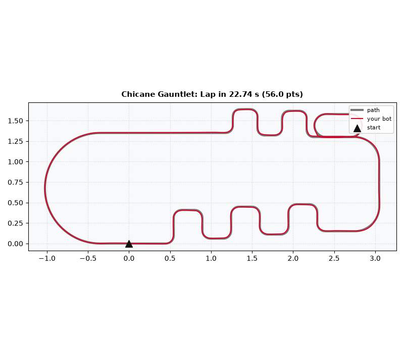

---

### Crossfire
**Category:** Intersections & Crossings &bull; **Length:** 14.31 m &bull; **Hazards:** 2 Gaps, 1 Slip Zone, 1 Shadow &bull; **Format:** [`maps/crossfire.json`](maps/crossfire.json)

> Multiple diagonal and orthogonal track crossings paired with curved gaps and shadow transitions. Tests branch discrimination and rejection of intersecting lines.


---

### Crossings Maze
**Category:** Intersections & Crossings &bull; **Length:** 7.93 m &bull; **Hazards:** 1 Slip Zone, 1 Shadow &bull; **Format:** [`maps/crossings_maze.json`](maps/crossings_maze.json)

> Complex maze of intersecting grid paths testing multi-branch disambiguation, centroid gating, and straight-through routing over multi-line junctions.

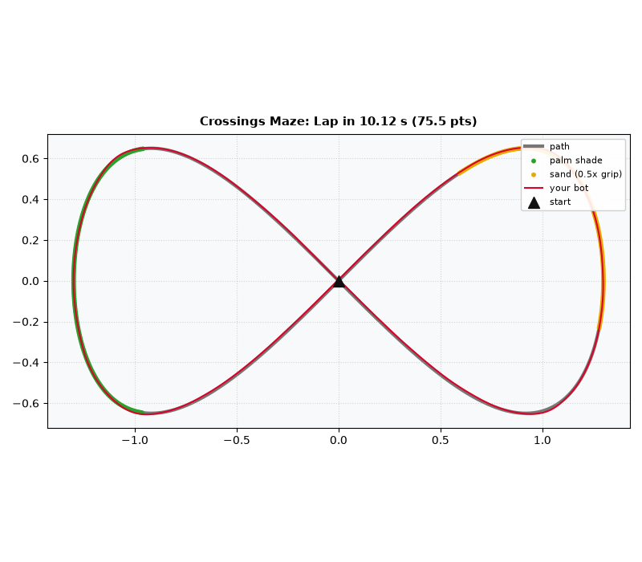

---

### Curved Gap Test
**Category:** Gaps & Dead-Reckoning &bull; **Length:** 7.39 m &bull; **Hazards:** 1 Gap, 1 Shadow &bull; **Format:** [`maps/curved_gap_test.json`](maps/curved_gap_test.json)

> Benchmark designed specifically to test dead-reckoning and curvature extrapolation across missing track sections without direct sensor feedback.


---

### Death Chicane
**Category:** High-Curvature & Slip &bull; **Length:** 6.96 m &bull; **Hazards:** 1 Slip Zone, 1 Shadow &bull; **Format:** [`maps/death_chicane.json`](maps/death_chicane.json)

> Ultra-tight high-speed chicane placed directly on a low-friction surface with low-contrast lighting, punishing excessive corner entry speed with lateral spin-outs.

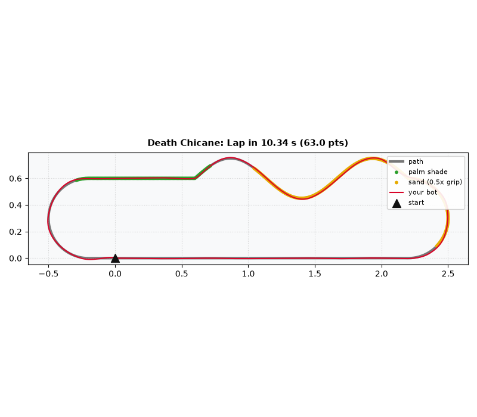

---

### Extreme Chicane
**Category:** High-Curvature & Slip &bull; **Length:** 6.83 m &bull; **Hazards:** 1 Slip Zone, 1 Shadow &bull; **Format:** [`maps/extreme_chicane.json`](maps/extreme_chicane.json)

> Demanding chicane layout combining sudden directional transitions on low-traction terrain, requiring dynamic velocity derating based on path curvature.


---

### Extreme Zigzag
**Category:** High-Frequency Switchbacks &bull; **Length:** 10.52 m &bull; **Hazards:** 1 Gap, 1 Slip Zone, 1 Shadow &bull; **Format:** [`maps/extreme_zigzag.json`](maps/extreme_zigzag.json)

> Rapid high-frequency directional switchbacks testing lateral damping, high derivative response, and steering-priority actuator saturation.


---

### Figure Eight
**Category:** Baseline & Crossings &bull; **Length:** 7.32 m &bull; **Hazards:** 1 Shadow &bull; **Format:** [`maps/figure_eight.json`](maps/figure_eight.json)

> Classic figure-8 crossover testing clean intersection transit, equal left/right turn dynamics, and symmetric wheel differential handling.

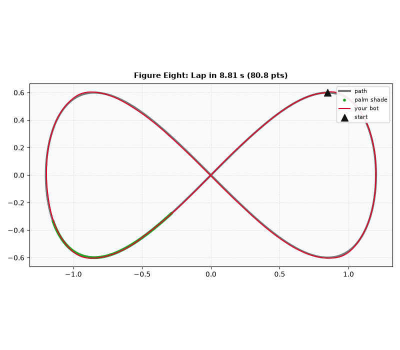

---

### Grand Exam
**Category:** Endurance & Multi-Hazard &bull; **Length:** 31.66 m &bull; **Hazards:** 3 Gaps, 2 Slip Zones, 3 Shadows &bull; **Format:** [`maps/grand_exam.json`](maps/grand_exam.json)

> Massive 31.66 m comprehensive endurance circuit featuring every major track challenge: hairpins, line gaps, low friction, shadow zones, and diagonal crossings.

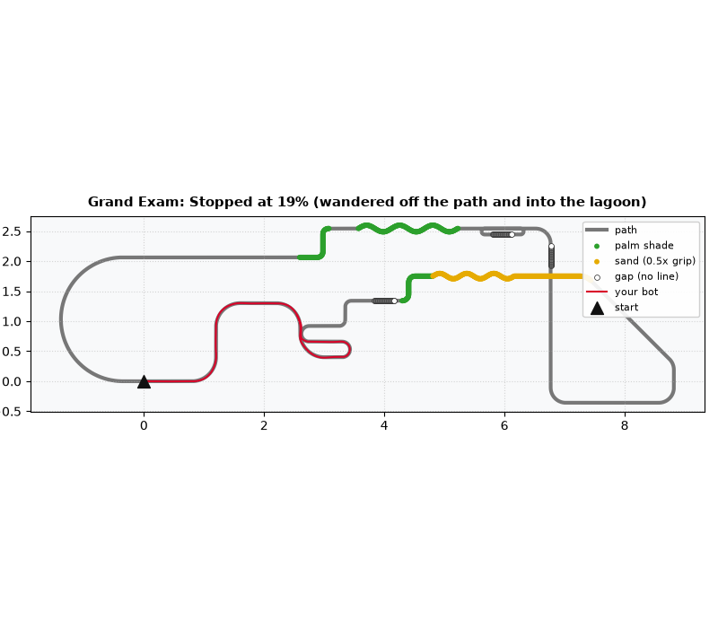

---

### Hairpin Hell
**Category:** High-Curvature & Hairpins &bull; **Length:** 9.84 m &bull; **Hazards:** 1 Slip Zone, 1 Shadow &bull; **Format:** [`maps/hairpin_hell.json`](maps/hairpin_hell.json)

> A tortuous endurance circuit of consecutive minimum-radius hairpin turns under varying traction conditions, demanding precise centripetal acceleration limits.

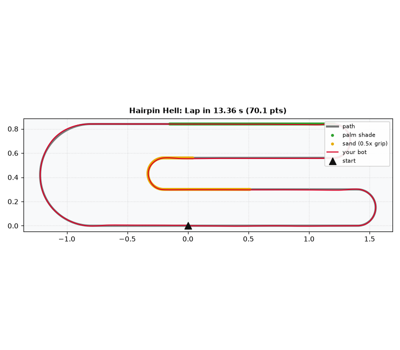

---

### Lagoon Run
**Category:** Multi-Hazard Benchmark &bull; **Length:** 9.24 m &bull; **Hazards:** 1 Gap, 1 Slip Zone, 1 Shadow &bull; **Format:** [`maps/lagoon_run.json`](maps/lagoon_run.json)

> Standard multi-hazard benchmark with broken line gaps, low-contrast shadow regions, and reduced-friction terrain. A classic test for adaptive line followers.


---

### Mega Slalom
**Category:** Slalom & Continuous Weave &bull; **Length:** 9.87 m &bull; **Hazards:** 1 Gap, 1 Slip Zone, 1 Shadow &bull; **Format:** [`maps/mega_slalom.json`](maps/mega_slalom.json)

> Extended slalom weaving course testing continuous sinusoidal tracking, phase lead, and grip management across variable surface traction and lighting.

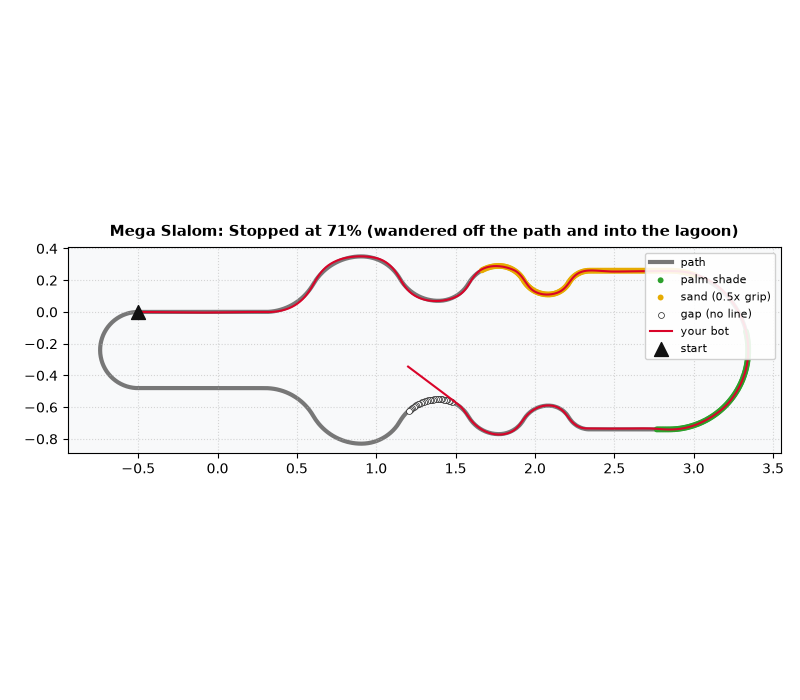

---

### Needle's Eye
**Category:** Parallel Line Rejection &bull; **Length:** 13.17 m &bull; **Hazards:** 1 Gap, 1 Slip Zone, 1 Shadow &bull; **Format:** [`maps/needles_eye.json`](maps/needles_eye.json)

> Hazardous parallel lines placed just 10 cm apart with an intermediate gap, testing adjacent track rejection vs true line reacquisition.

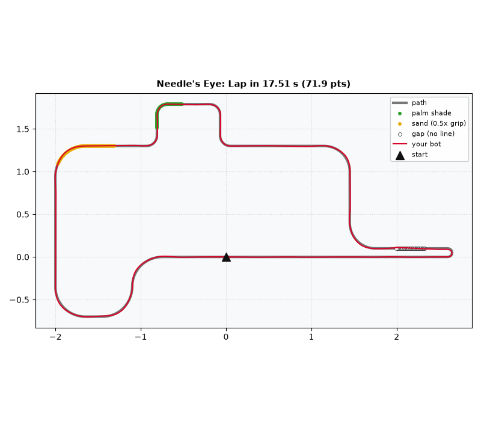

---

### Palm Labyrinth
**Category:** Low-Contrast Shadows & Gaps &bull; **Length:** 14.03 m &bull; **Hazards:** 3 Gaps, 1 Slip Zone, 2 Shadows &bull; **Format:** [`maps/palm_labyrinth.json`](maps/palm_labyrinth.json)

> Deep shadow environment with multiple gaps placed inside low-contrast illumination zones, testing optical sensor gain adaptation and dynamic thresholding.


---

### Quicksand Spiral
**Category:** Low Friction & Spirals &bull; **Length:** 15.58 m &bull; **Hazards:** 3 Slip Zones &bull; **Format:** [`maps/quicksand_spiral.json`](maps/quicksand_spiral.json)

> Tightening logarithmic spiral entirely situated on low-traction surface (half grip, reduced speed limit), requiring steady centripetal speed reduction.


---

### Sharp 90 Castle
**Category:** 90-Degree Corners & Pivots &bull; **Length:** 6.00 m &bull; **Hazards:** 1 Shadow &bull; **Format:** [`maps/sharp_90_castle.json`](maps/sharp_90_castle.json)

> Square battlement track with true zero-radius 90-degree right angles in shadowed lighting. Tests discrete pivot-in-place turns and corner re-acquisition.

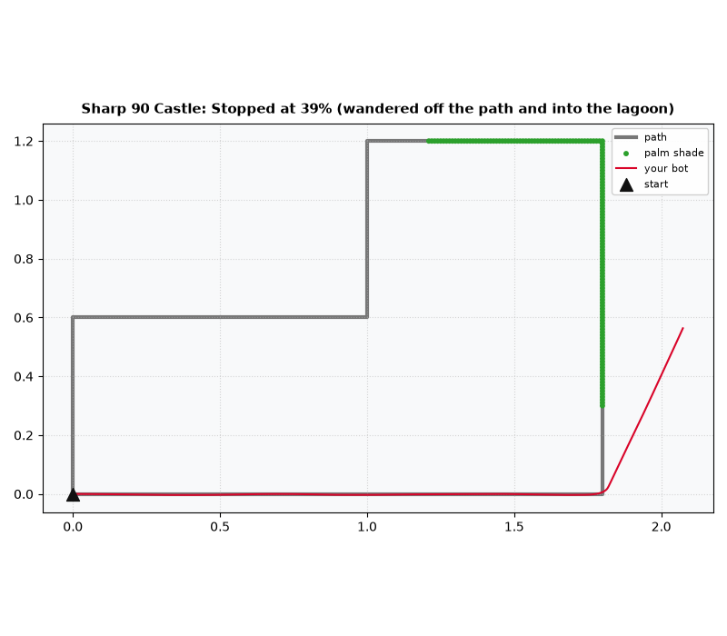

---

### The Gauntlet
**Category:** Multi-Hazard Stress Test &bull; **Length:** 14.54 m &bull; **Hazards:** 3 Gaps, 1 Slip Zone, 2 Shadows &bull; **Format:** [`maps/the_gauntlet.json`](maps/the_gauntlet.json)

> Punishing obstacle run combining curved gaps, low-contrast shadows, and low-friction zones in rapid succession, challenging state machine transitions.

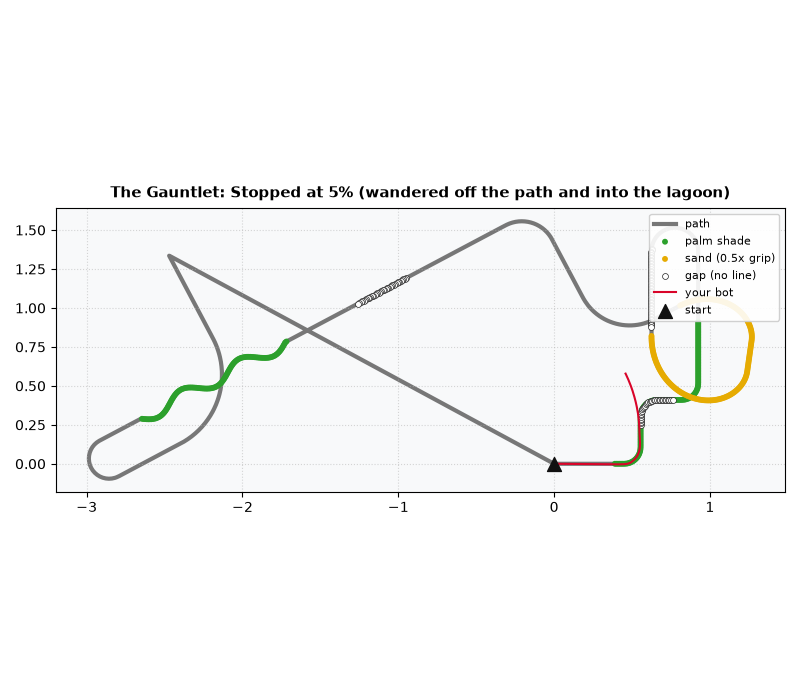

---

### Torture Test
**Category:** Compact Stress Benchmark &bull; **Length:** 5.22 m &bull; **Hazards:** 1 Gap, 1 Slip Zone, 1 Shadow &bull; **Format:** [`maps/torture_test.json`](maps/torture_test.json)

> Compact stress track condensing sharp directional transitions, gaps, low-friction patches, and shadow zones into a concentrated 5.22 m loop.

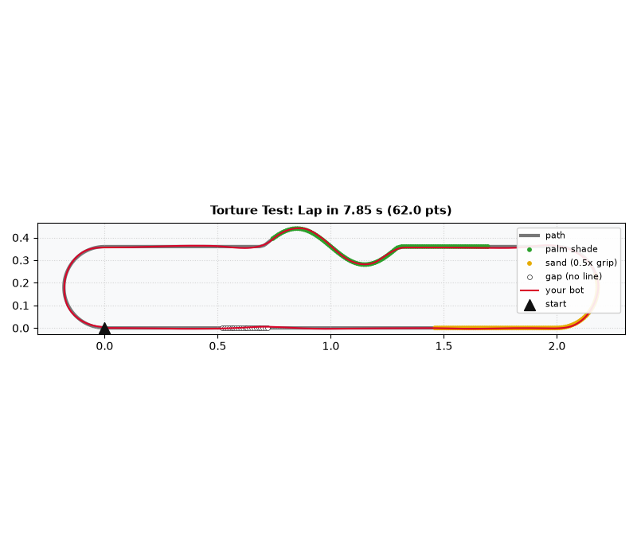

---

### Washboard
**Category:** Sinusoidal Inflection Gaps &bull; **Length:** 14.96 m &bull; **Hazards:** 1 Gap, 1 Slip Zone, 1 Shadow &bull; **Format:** [`maps/washboard.json`](maps/washboard.json)

> High-frequency sinusoidal wave with gaps situated at curvature inflection points, challenging curvature estimators that rely on static heading extrapolation.


---


---

## 🎯 Use Cases

- **Control Systems Benchmarking:** Evaluate PID, Linear Quadratic Regulators (LQR), Model Predictive Control (MPC), Stanley, and Pure Pursuit controllers on challenging tracks.
- **Sensor Array Optimization:** Simulate and benchmark reflectance IR sensor bar configurations, spacing, dirty sensor recovery, and Kalman filtering.
- **Traction & Chassis Dynamics:** Test slip detection, steering-priority actuator saturation, and centripetal grip derating algorithms.
- **Robotics Competitions:** Standard training ground for national and international robotics line-follower competitions (RoboChallenger, All Japan Micromouse / Line Tracer, RobotChallenge).

---

## 📄 License

This repository and all included track assets are released under the [MIT License](LICENSE). Feel free to use them in academic research, educational courses, and competitive robotics.
