# 🗺️ Isla ReRo Map Archive

A curated archive of **22 benchmark and stress-test tracks** designed for the **Isla ReRo autonomous line-follower robot** simulation environment.

Each track includes:
- **`maps/<name>.json`**: Complete vector definition (points, line width, zones for gaps, palm shade, and sand).
- **`images/<name>.png`**: High-resolution visualization with terrain overlays (white gaps, goldenrod sand, green shade) and robot trajectory plots.

---

## 📊 Track Catalog

| Track Name | JSON File | Length | Hazards | Definition | Visualization |
|:---|:---|:---:|:---|:---:|:---:|
| [Blind Hairpins](#blind-hairpins) | `blind_hairpins.json` | 12.45 m | 5 Gaps | [JSON](maps/blind_hairpins.json) | [View](#blind-hairpins) |
| [Boardwalk Loop](#boardwalk-loop) | `boardwalk_loop.json` | 8.83 m | None (Clean) | [JSON](maps/boardwalk_loop.json) | [View](#boardwalk-loop) |
| [Broken Lagoon](#broken-lagoon) | `broken_lagoon.json` | 7.91 m | 2 Gaps, 1 Sand, 1 Shade | [JSON](maps/broken_lagoon.json) | [View](#broken-lagoon) |
| [Chicane Gauntlet](#chicane-gauntlet) | `chicane_gauntlet.json` | 13.92 m | None (Clean) | [JSON](maps/chicane_gauntlet.json) | [View](#chicane-gauntlet) |
| [Crossfire](#crossfire) | `crossfire.json` | 14.31 m | 2 Gaps, 1 Sand, 1 Shade | [JSON](maps/crossfire.json) | [View](#crossfire) |
| [Crossings Maze](#crossings-maze) | `crossings_maze.json` | 7.93 m | 1 Sand, 1 Shade | [JSON](maps/crossings_maze.json) | [View](#crossings-maze) |
| [Curved Gap Test](#curved-gap-test) | `curved_gap_test.json` | 7.39 m | 1 Gap, 1 Shade | [JSON](maps/curved_gap_test.json) | [View](#curved-gap-test) |
| [Death Chicane](#death-chicane) | `death_chicane.json` | 6.96 m | 1 Sand, 1 Shade | [JSON](maps/death_chicane.json) | [View](#death-chicane) |
| [Extreme Chicane](#extreme-chicane) | `extreme_chicane.json` | 6.83 m | 1 Sand, 1 Shade | [JSON](maps/extreme_chicane.json) | [View](#extreme-chicane) |
| [Extreme Zigzag](#extreme-zigzag) | `extreme_zigzag.json` | 10.52 m | 1 Gap, 1 Sand, 1 Shade | [JSON](maps/extreme_zigzag.json) | [View](#extreme-zigzag) |
| [Figure Eight](#figure-eight) | `figure_eight.json` | 7.32 m | 1 Shade | [JSON](maps/figure_eight.json) | [View](#figure-eight) |
| [Grand Exam](#grand-exam) | `grand_exam.json` | 31.66 m | 3 Gaps, 2 Sand, 3 Shade | [JSON](maps/grand_exam.json) | [View](#grand-exam) |
| [Hairpin Hell](#hairpin-hell) | `hairpin_hell.json` | 9.84 m | 1 Sand, 1 Shade | [JSON](maps/hairpin_hell.json) | [View](#hairpin-hell) |
| [Lagoon Run](#lagoon-run) | `lagoon_run.json` | 9.24 m | 1 Gap, 1 Sand, 1 Shade | [JSON](maps/lagoon_run.json) | [View](#lagoon-run) |
| [Mega Slalom](#mega-slalom) | `mega_slalom.json` | 9.87 m | 1 Gap, 1 Sand, 1 Shade | [JSON](maps/mega_slalom.json) | [View](#mega-slalom) |
| [Needle's Eye](#needles-eye) | `needles_eye.json` | 13.17 m | 1 Gap, 1 Sand, 1 Shade | [JSON](maps/needles_eye.json) | [View](#needles-eye) |
| [Palm Labyrinth](#palm-labyrinth) | `palm_labyrinth.json` | 14.03 m | 3 Gaps, 1 Sand, 2 Shade | [JSON](maps/palm_labyrinth.json) | [View](#palm-labyrinth) |
| [Quicksand Spiral](#quicksand-spiral) | `quicksand_spiral.json` | 15.58 m | 3 Sand | [JSON](maps/quicksand_spiral.json) | [View](#quicksand-spiral) |
| [Sharp 90 Castle](#sharp-90-castle) | `sharp_90_castle.json` | 6.00 m | 1 Shade | [JSON](maps/sharp_90_castle.json) | [View](#sharp-90-castle) |
| [The Gauntlet](#the-gauntlet) | `the_gauntlet.json` | 14.54 m | 3 Gaps, 1 Sand, 2 Shade | [JSON](maps/the_gauntlet.json) | [View](#the-gauntlet) |
| [Torture Test](#torture-test) | `torture_test.json` | 5.22 m | 1 Gap, 1 Sand, 1 Shade | [JSON](maps/torture_test.json) | [View](#torture-test) |
| [Washboard](#washboard) | `washboard.json` | 14.96 m | 1 Gap, 1 Sand, 1 Shade | [JSON](maps/washboard.json) | [View](#washboard) |

---

## 🖼️ Map Gallery

### Blind Hairpins
**File:** [`maps/blind_hairpins.json`](maps/blind_hairpins.json) &bull; **Length:** 12.45 m &bull; **Hazards:** 5 Gaps

> High-density sequence of sharp R=0.08m hairpin curves with gaps placed directly at curve apexes.

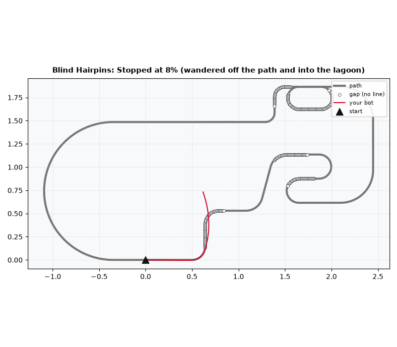

---

### Boardwalk Loop
**File:** [`maps/boardwalk_loop.json`](maps/boardwalk_loop.json) &bull; **Length:** 8.83 m &bull; **Hazards:** None (Clean)

> The standard clean practice loop featuring sweeping high-speed curves and long straights with zero hazards.

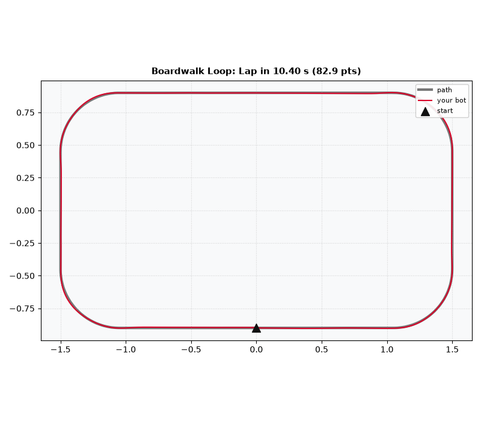

---

### Broken Lagoon
**File:** [`maps/broken_lagoon.json`](maps/broken_lagoon.json) &bull; **Length:** 7.91 m &bull; **Hazards:** 2 Gaps, 1 Sand, 1 Shade

> Variant of Lagoon Run featuring multiple broken boardwalk gaps, palm shade, and sand traps.

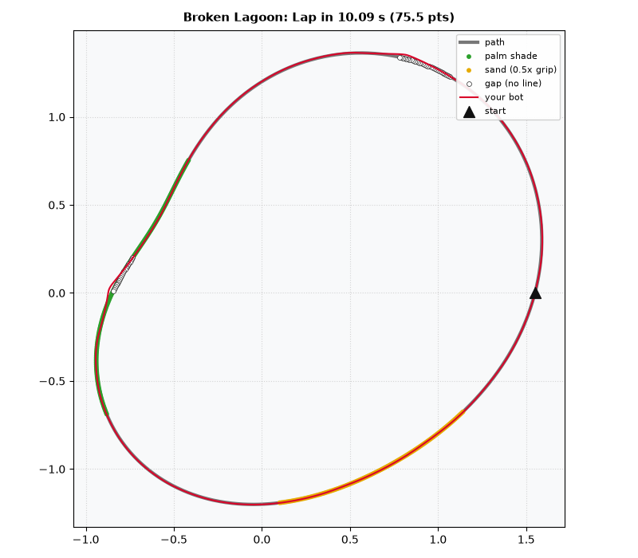

---

### Chicane Gauntlet
**File:** [`maps/chicane_gauntlet.json`](maps/chicane_gauntlet.json) &bull; **Length:** 13.92 m &bull; **Hazards:** None (Clean)

> Brutal series of alternating tight S-curves testing actuator phase lead, motor time constant compensation, and centripetal grip budgeting.

---

### Crossfire
**File:** [`maps/crossfire.json`](maps/crossfire.json) &bull; **Length:** 14.31 m &bull; **Hazards:** 2 Gaps, 1 Sand, 1 Shade

> Multiple diagonal and orthogonal track crossings paired with curved gaps and palm shade transitions.

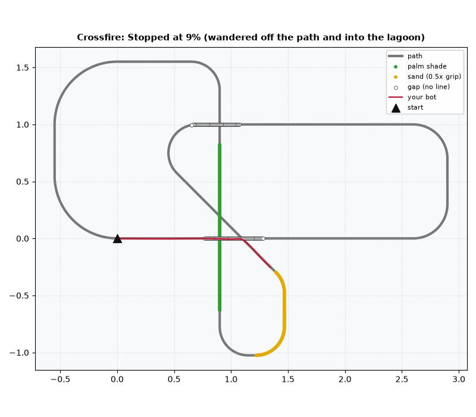

---

### Crossings Maze
**File:** [`maps/crossings_maze.json`](maps/crossings_maze.json) &bull; **Length:** 7.93 m &bull; **Hazards:** 1 Sand, 1 Shade

> Complex maze of intersecting grid paths testing multi-branch disambiguation and straight-through routing.

---

### Curved Gap Test
**File:** [`maps/curved_gap_test.json`](maps/curved_gap_test.json) &bull; **Length:** 7.39 m &bull; **Hazards:** 1 Gap, 1 Shade

> Benchmark designed specifically to test dead-reckoning and curvature extrapolation across missing track sections.

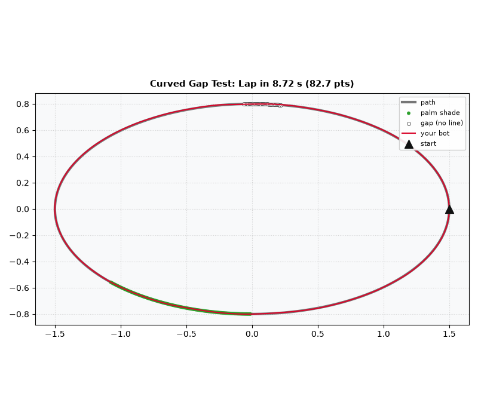

---

### Death Chicane
**File:** [`maps/death_chicane.json`](maps/death_chicane.json) &bull; **Length:** 6.96 m &bull; **Hazards:** 1 Sand, 1 Shade

> Ultra-tight high-speed chicane placed right on low-friction sand with low-contrast palm shade.

---

### Extreme Chicane
**File:** [`maps/extreme_chicane.json`](maps/extreme_chicane.json) &bull; **Length:** 6.83 m &bull; **Hazards:** 1 Sand, 1 Shade

> Demanding chicane layout combining sudden directional transitions on low-traction sand terrain.

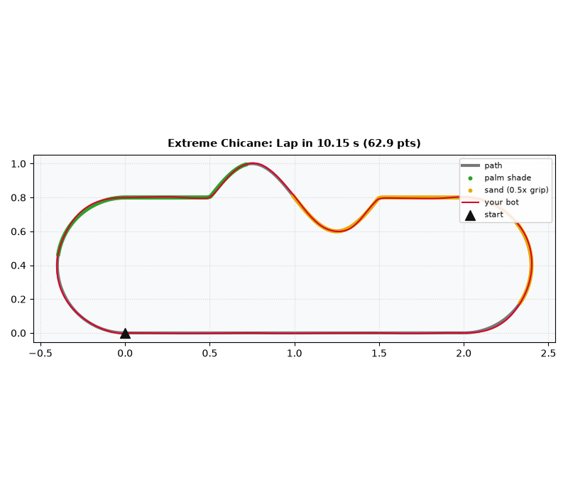

---

### Extreme Zigzag
**File:** [`maps/extreme_zigzag.json`](maps/extreme_zigzag.json) &bull; **Length:** 10.52 m &bull; **Hazards:** 1 Gap, 1 Sand, 1 Shade

> Rapid high-frequency directional switchbacks testing lateral damping and steering-priority saturation.

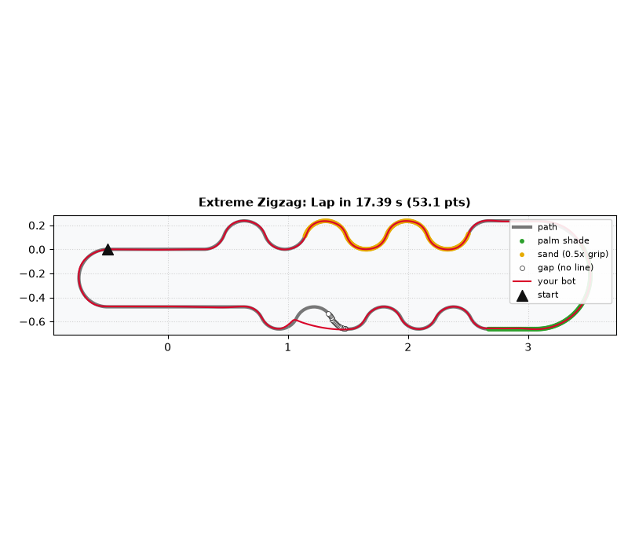

---

### Figure Eight
**File:** [`maps/figure_eight.json`](maps/figure_eight.json) &bull; **Length:** 7.32 m &bull; **Hazards:** 1 Shade

> Classic figure-8 crossover testing clean intersection transit and symmetrical left/right turn dynamics.

---

### Grand Exam
**File:** [`maps/grand_exam.json`](maps/grand_exam.json) &bull; **Length:** 31.66 m &bull; **Hazards:** 3 Gaps, 2 Sand, 3 Shade

> Massive 31.66m comprehensive marathon circuit featuring every island hazard: hairpins, gaps, sand, shade, and diagonal crossings.

---

### Hairpin Hell
**File:** [`maps/hairpin_hell.json`](maps/hairpin_hell.json) &bull; **Length:** 9.84 m &bull; **Hazards:** 1 Sand, 1 Shade

> A tortuous endurance circuit of consecutive minimum-radius hairpin turns under varying traction conditions.

---

### Lagoon Run
**File:** [`maps/lagoon_run.json`](maps/lagoon_run.json) &bull; **Length:** 9.24 m &bull; **Hazards:** 1 Gap, 1 Sand, 1 Shade

> The official multi-hazard practice circuit with broken boardwalk gaps, low-contrast palm shade, and sand traps.

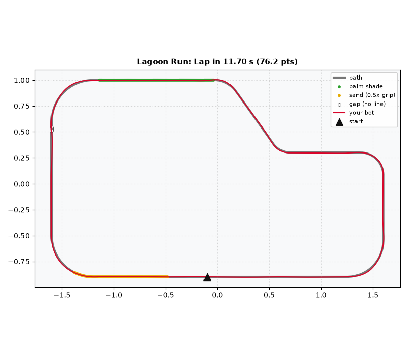

---

### Mega Slalom
**File:** [`maps/mega_slalom.json`](maps/mega_slalom.json) &bull; **Length:** 9.87 m &bull; **Hazards:** 1 Gap, 1 Sand, 1 Shade

> Extended slalom weaving course testing continuous sinusoidal tracking and grip management across sand and shade.

---

### Needle's Eye
**File:** [`maps/needles_eye.json`](maps/needles_eye.json) &bull; **Length:** 13.17 m &bull; **Hazards:** 1 Gap, 1 Sand, 1 Shade

> Hazardous parallel lines placed just 10cm apart with an intermediate gap, testing track attraction vs parallel track rejection.

---

### Palm Labyrinth
**File:** [`maps/palm_labyrinth.json`](maps/palm_labyrinth.json) &bull; **Length:** 14.03 m &bull; **Hazards:** 3 Gaps, 1 Sand, 2 Shade

> Deep shade forest with multiple gaps placed inside low-contrast illumination zones.

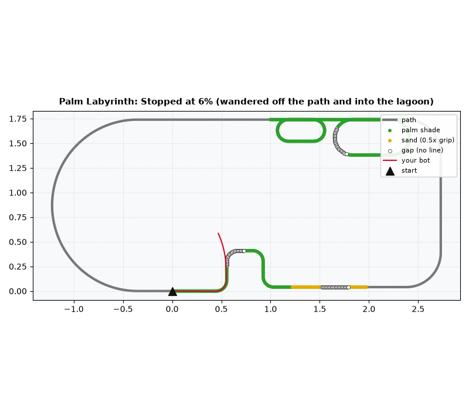

---

### Quicksand Spiral
**File:** [`maps/quicksand_spiral.json`](maps/quicksand_spiral.json) &bull; **Length:** 15.58 m &bull; **Hazards:** 3 Sand

> Tightening logarithmic spiral entirely across low-traction sand (half grip, 0.7x speed).

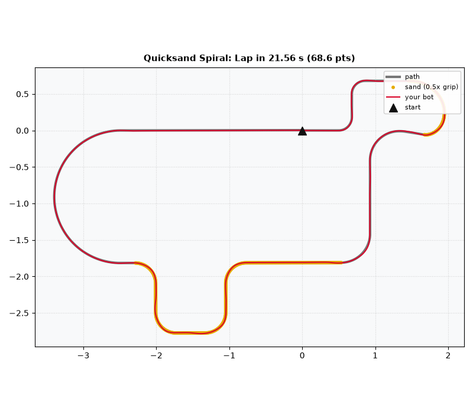

---

### Sharp 90 Castle
**File:** [`maps/sharp_90_castle.json`](maps/sharp_90_castle.json) &bull; **Length:** 6.00 m &bull; **Hazards:** 1 Shade

> Square castle battlement track with true zero-radius 90-degree right angles in palm shade.

---

### The Gauntlet
**File:** [`maps/the_gauntlet.json`](maps/the_gauntlet.json) &bull; **Length:** 14.54 m &bull; **Hazards:** 3 Gaps, 1 Sand, 2 Shade

> Punishing obstacle run combining curved gaps, low-contrast palm shade, and sand traps in rapid succession.

---

### Torture Test
**File:** [`maps/torture_test.json`](maps/torture_test.json) &bull; **Length:** 5.22 m &bull; **Hazards:** 1 Gap, 1 Sand, 1 Shade

> Compact stress track condensing sharp directional transitions, gaps, sand, and shade into a 5.22m loop.

---

### Washboard
**File:** [`maps/washboard.json`](maps/washboard.json) &bull; **Length:** 14.96 m &bull; **Hazards:** 1 Gap, 1 Sand, 1 Shade

> High-frequency sinusoidal wave with gaps situated at curvature inflection points.

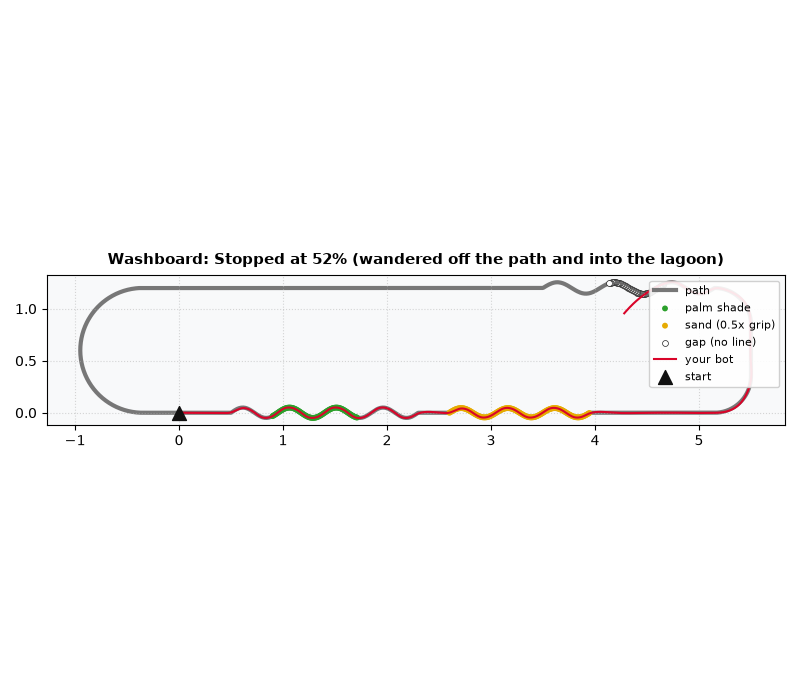

---

